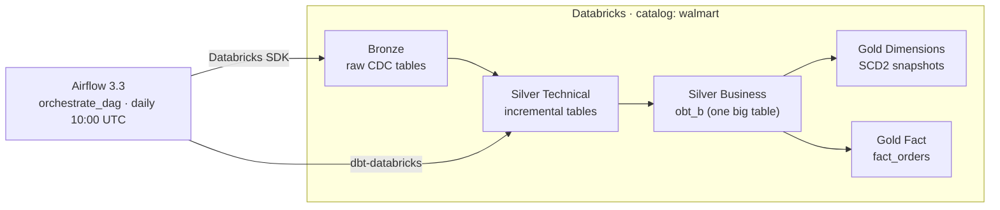

# Walmart Retail Lakehouse — Airflow · dbt · Databricks

A batch ELT pipeline that ingests retail data into **Databricks**, models it with **dbt** using a medallion architecture (Bronze → Silver → Gold), and runs daily on **Apache Airflow 3** in Docker.

## Architecture



## Pipeline

```
ingest_cdc → source_freshness → silver_tech (+ tests) → silver_bus (+ tests) → gold dimensions → gold facts
```

| Layer | Schema | Description |
|-------|--------|-------------|
| Bronze | `walmart.bronze` | Raw orders, order_items, customers, products, stores, employees loaded by a Databricks CDC job |
| Silver Technical | `walmart.silver_tech` | Incremental upserts per table, filtered on `updated_timestamp` |
| Silver Business | `walmart.silver_bus` | `obt_b`: all entities joined into one denormalised table |
| Gold | `walmart.gold` | Star schema: 5 SCD Type 2 dimensions (dbt snapshots) and `fact_orders` |

## Tech Stack

Apache Airflow 3.3 · dbt-core + dbt-databricks · Databricks SQL Warehouse · Delta Lake · Unity Catalog · Docker Compose

## Project Structure

```
airflow_dbt_databricks_project/
├── dags/orchestrate.py        # Airflow DAG
├── walmart_project/           # dbt project
│   ├── models/                # source, silver_tech, silver_bus, gold
│   ├── snapshots/             # SCD2 dimensions
│   └── macros/                # custom schema naming
├── Dockerfile
├── docker-compose.yaml
└── requirements.txt
```

